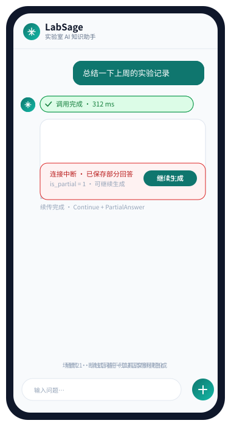
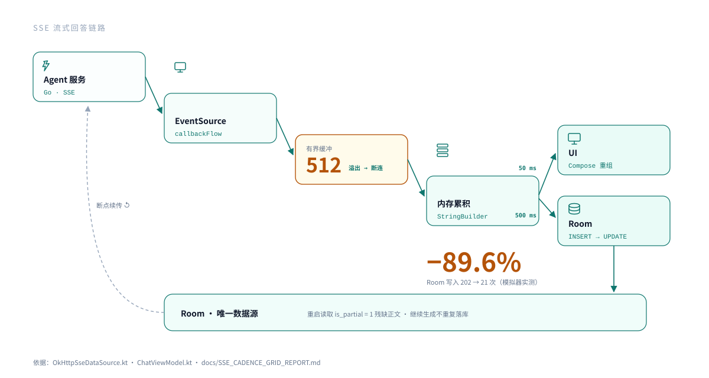

<!-- TODO: 把下方两处 YOUR_GITHUB_USERNAME 替换为你的 GitHub 用户名（推送后徽章才会显示） -->

<div align="center">

# LabSage · 实验室 AI 知识助手 Android 客户端

面向实验室知识检索与环境查询场景，对接 Agent 服务（Go · ReAct · SSE 流式）的原生 Android 客户端。

支持 **AI 流式问答 · 异常状态恢复 · 工具调用过程可视化 · 账号认证 · 历史同步**

[](https://github.com/YOUR_GITHUB_USERNAME/LabSage/actions/workflows/ci.yml)




<sub>SVG 动画演示 · 场景 1：流式问答 + 工具调用可视化；场景 2：断线后基于残缺正文继续生成</sub>

</div>

---

## 核心亮点

### 1 · 架构与状态建模

Kotlin + Jetpack Compose，**MVVM + Repository** 分离 UI、网络与数据层；用 **StateFlow + 密封类**建模 `Idle / Streaming / Completed / Error` 流式回答生命周期。Room 是唯一数据源——流式期间切换为内存快照并暂停 Room 观察，终态后恢复冷 Flow 做一次权威对账，全程单向数据流。

> [`ChatViewModel.kt`](app/src/main/java/com/labsage/app/ui/chat/ChatViewModel.kt) · [`StreamState.kt`](app/src/main/java/com/labsage/app/domain/model/StreamState.kt)

### 2 · SSE 背压保护

工具查询会突发 200+ 条 trace/message 事件。trace 按结构化前缀（`[tool] [react] [route]`）过滤后，进入**固定 512 容量的有界缓冲**；消费端跟不上时**取消连接并显式报错**——以失败代替无界堆积与静默丢失。

> [`OkHttpSseDataSource.kt`](app/src/main/java/com/labsage/app/data/remote/OkHttpSseDataSource.kt)（`callbackFlow + awaitClose` 桥接 `EventSourceListener`）

### 3 · 流式链路优化与异常恢复

正文在内存（`StringBuilder`）顺序累积，**UI 发布（50 ms）与 Room 落盘（500 ms）分通道节流**；收到 `done / error` 终态立即落盘，不等节流窗口。进程重启后从 Room 读到 `is_partial = 1` 的残缺正文，**继续生成 = `Continue + PartialAnswer`**，服务端不重复落库。以旧「每 5 chunk 一写」为基线回放**真实录制的 SSE trace**，写入次数降低 **82%–97%**（直答 −81.8%，工具查询簇发 −97.1%）。

> [`SseUpdateCadence.kt`](app/src/main/java/com/labsage/app/ui/chat/SseUpdateCadence.kt) · [`ChatRecovery.kt`](app/src/main/java/com/labsage/app/ui/chat/ChatRecovery.kt) · [实测报告](docs/SSE_CADENCE_GRID_REPORT.md)

### 4 · 认证与历史同步

登录态以 **Android Keystore + AES-GCM** 加密存储；历史**按账号隔离**缓存于 Room（`owner_user_id`），服务端 → 端上**游标增量拉取**，同步结果与游标在**同一事务**提交——崩溃后不重复拉取。

> [`KeystoreAuthSessionStore.kt`](app/src/main/java/com/labsage/app/data/auth/KeystoreAuthSessionStore.kt) · [`HistorySyncCoordinator.kt`](app/src/main/java/com/labsage/app/data/sync/HistorySyncCoordinator.kt) · [`RoomHistorySyncStore.kt`](app/src/main/java/com/labsage/app/data/sync/RoomHistorySyncStore.kt)

---

## 流式链路

事件从 Agent 服务出发，逐级沉淀到 Room；左侧回环是断点续传：



- **级联主体**：Agent SSE → EventSource（`callbackFlow`）→ 有界缓冲 512 → 内存累积 → 分两路按各自节奏消费（UI 50 ms / Room 500 ms）。
- **底座**：Room 是唯一数据源，承载重启恢复与断点续传。
- **数据**：写入降幅来自真实后端 trace 录制回放（`scripts/record_sse_trace.py` 录制 → 模拟器 30 轮 A/B），基线是旧「每 5 chunk 一写」策略；高密度合成负载下为 −90.05%，详见[报告](docs/SSE_CADENCE_GRID_REPORT.md)。

---

## 技术栈

| 层 | 选型 |
|---|---|
| 语言 | Kotlin 2.2（协程 · Flow / StateFlow · 密封类） |
| UI | Jetpack Compose · Material 3 · Navigation Compose |
| 网络 | OkHttp + okhttp-sse（SSE 流式）· Retrofit（REST） |
| 持久化 | Room 2.7（含迁移测试）· Preferences DataStore · Android Keystore |
| 架构 | MVVM + Repository + 手动 DI（依赖图简单，透明可调试） |
| 质量 | JUnit + MockWebServer · 仪器测试与基准 · LeakCanary · GitHub Actions |

## 数据与实测

| 指标 | 结果 | 依据 |
|---|---|---|
| SSE 期间 Room 持久化次数 | 真实 trace 回放 **−81.8%（直答）/ −97.1%（工具查询簇发）**；高密度合成负载 202 → 21（−90.05%） | [参数网格与真实 trace 报告](docs/SSE_CADENCE_GRID_REPORT.md) |
| 文件上传堆内存增量中位数 | **−98.7% ~ −99.1%**（180 样本 A/B，SHA-256 校验输出一致） | [上传基准报告](docs/UPLOAD_BENCHMARK.md) |
| 包体积（R8 + resource shrink） | **20.83 → 2.58 MB（−87.6%）** | [优化记录](docs/PERF_BASELINE.md) |
| 冷启动（模拟器 ×10 中位） | 408 ms → AOT 上界 **304 ms（−25.5%）**，BP 待生成 | [优化记录](docs/PERF_BASELINE.md) |
| 崩溃闭环 | 捕获→落盘→下次启动上报→后端聚合，端到端实测 | [优化记录](docs/PERF_BASELINE.md) |
| 测试 | 70 单元测试 + 41 仪器测试（含真实 trace 回放基准），CI 每次推送运行 | [ci.yml](.github/workflows/ci.yml) |

## 快速开始

```bash
./gradlew :app:assembleDebug        # 构建 Debug APK
./gradlew :app:testDebugUnitTest    # 运行单元测试
./gradlew :app:lintDebug            # Android Lint
```

- 后端地址在构建期固定（`BuildConfig.API_BASE_URL`），Debug 默认 `http://10.0.2.2:6872/`（模拟器映射宿主机）。
- 仪器测试（`connectedDebugAndroidTest`）需要模拟器/真机；其中 `RealBackendSmokeTest` 与性能基准需要真实后端，故不在 CI 内。

## 附录

<details>
<summary><b>更多文档（架构 / 实测 / 排错 / 契约）</b></summary>

| 文档 | 内容 |
|---|---|
| [ARCHITECTURE.md](docs/ARCHITECTURE.md) | 整体架构、SSE 协议、Room 表设计、关键决策 |
| [CADENCE_DECISION_SPACE.md](docs/CADENCE_DECISION_SPACE.md) | 50/500 ms 的四维度决策证据（视觉连续性 / 调度 / 写入 / 崩溃丢失） |
| [SSE_CADENCE_GRID_REPORT.md](docs/SSE_CADENCE_GRID_REPORT.md) | 50/500 ms 参数网格实测 + 真实 trace 复现（−82%~−97%） |
| [UPLOAD_BENCHMARK.md](docs/UPLOAD_BENCHMARK.md) | 流式上传 A/B 实验（180 样本） |
| [BUGFIX_LOG.md](docs/BUGFIX_LOG.md) | 真实 Bug 复盘（背压丢事件、REPLACE 触发级联删除等） |
| [CITATION_DESIGN.md](docs/CITATION_DESIGN.md) | 引用角标：方案选型、wire 契约、双端实现 |

</details>

<details>
<summary><b>项目结构</b></summary>

```text
com.labsage.app/
├── data/
│   ├── remote/    # OkHttp SSE 数据源、Retrofit API、请求模型
│   ├── local/     # Room 数据库、实体、DAO、迁移
│   ├── sync/      # 历史同步协调器、游标存储（同事务提交）
│   ├── auth/      # 认证仓库、Keystore 加密会话存储
│   └── repository/# ChatRepository / SettingsRepository
├── domain/model/  # StreamState 流式状态机
├── ui/            # Compose 界面：chat / conversation / files / settings / auth
└── notification/  # 回答完成通知与深链定位
```

</details>

---

<div align="center">
<sub>Android 客户端独立完成；Agent 服务端为对接的现有 Go 后端（不在本仓库内）。</sub>
</div>
