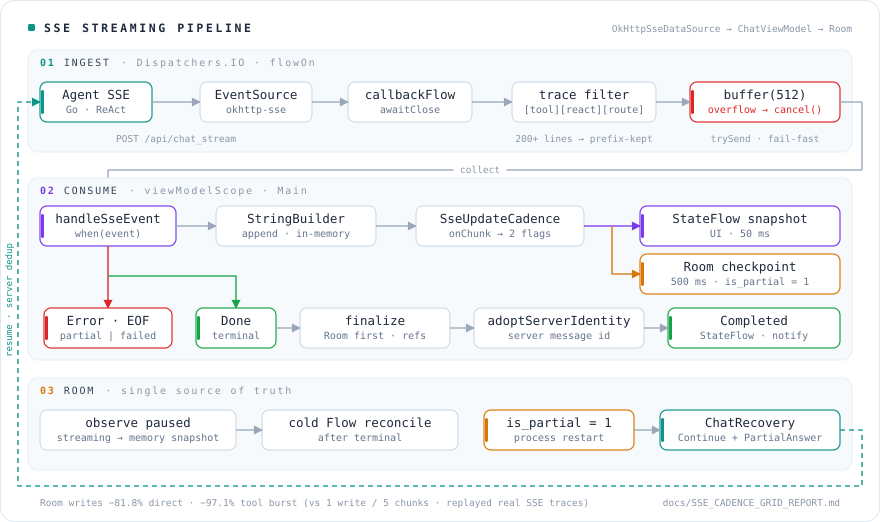
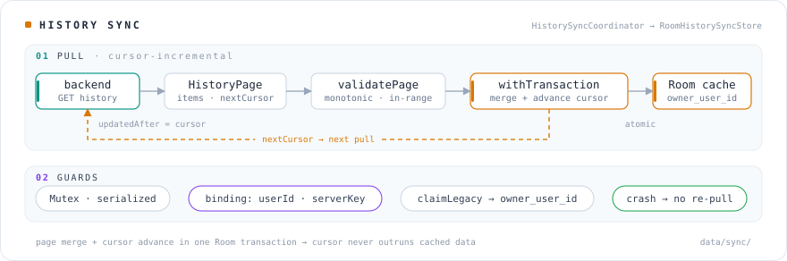
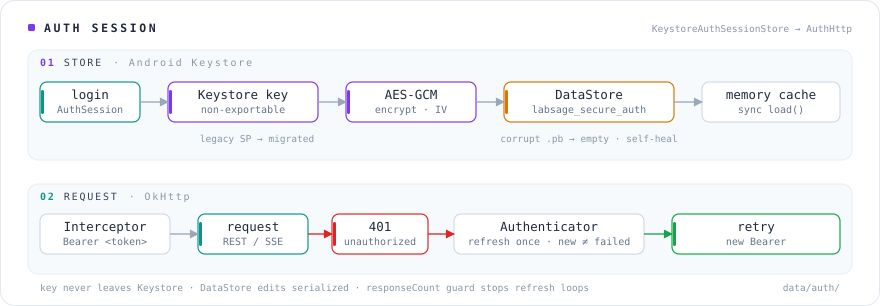

<div align="center">

# LabSage · 实验室 AI 知识助手 Android 客户端

面向实验室知识检索与服务器环境查询场景，对接 Agent 服务（Go · ReAct · SSE 流式）的原生 Android 客户端。

支持 **AI 流式问答 · 工具调用过程可视化 · 异常状态恢复 · 账号认证 · 历史同步 · 流式上传**

[](https://github.com/teletubbyies/LabSage/actions/workflows/ci.yml)


<sub>场景 1：流式问答 + 工具调用可视化；场景 2：断线后基于残缺正文继续生成</sub>

</div>

---

## 核心亮点
### 1 · 架构与状态建模

Kotlin + Jetpack Compose，**MVVM + Repository** 分离 UI、网络与数据层；用 **StateFlow + 密封类**建模 `Idle / Streaming / Completed / Error` 流式回答生命周期。Room 是唯一数据源——流式期间切换为内存快照并暂停 Room 观察，终态后恢复冷 Flow 做一次权威对账，全程单向数据流。

> [`ChatViewModel.kt`](app/src/main/java/com/labsage/app/ui/chat/ChatViewModel.kt) · [`StreamState.kt`](app/src/main/java/com/labsage/app/domain/model/StreamState.kt)

### 2 · SSE 背压保护与双通道节流

工具查询会突发 200+ 条 trace/message 事件。trace 按结构化前缀（`[tool] [react] [route]`）过滤后进入**固定 512 容量的有界缓冲**；消费端跟不上时**取消连接并显式报错**——以失败代替无界堆积与静默丢失。

正文在内存顺序累积，**UI 发布（50 ms）与 Room 落盘（500 ms）分通道节流**：前者保证视觉连续，后者控制写放大；收到 `done / error` 终态立即落盘，不等节流窗口。相比旧「每 5 chunk 一写」策略，持久化次数降低一个数量级。

> [`OkHttpSseDataSource.kt`](app/src/main/java/com/labsage/app/data/remote/OkHttpSseDataSource.kt)（`callbackFlow + awaitClose` 桥接 `EventSourceListener`）· [`SseUpdateCadence.kt`](app/src/main/java/com/labsage/app/ui/chat/SseUpdateCadence.kt)

### 3 · 异常恢复：断点续传

进程重启后从 Room 读到 `is_partial = 1` 的残缺正文，**继续生成 = `Continue + PartialAnswer`**：服务端基于残缺文本续写、不重复落库，用户不必从头再问。


> [`ChatRecovery.kt`](app/src/main/java/com/labsage/app/ui/chat/ChatRecovery.kt) 
### 4 · 认证与历史同步

登录态以 **Android Keystore + AES-GCM** 加密存储，密钥不出安全硬件；历史**按账号隔离**缓存于 Room（`owner_user_id`），服务端 → 端上**游标增量拉取**，页数据与游标在**同一事务**提交——崩溃后不重复拉取。

> [`KeystoreAuthSessionStore.kt`](app/src/main/java/com/labsage/app/data/auth/KeystoreAuthSessionStore.kt) · [`HistorySyncCoordinator.kt`](app/src/main/java/com/labsage/app/data/sync/HistorySyncCoordinator.kt) · [`RoomHistorySyncStore.kt`](app/src/main/java/com/labsage/app/data/sync/RoomHistorySyncStore.kt)

---

## Pipeline


### 流式回答

事件从 Agent 服务出发，逐级沉淀到 Room；左侧回环是断点续传：



- **INGEST**：Agent SSE → EventSource（`callbackFlow`）→ trace 前缀过滤 → 有界缓冲 512。
- **CONSUME**：`StringBuilder` 内存累积 → 分两路按各自节奏消费（UI 50 ms / Room 500 ms）。
- **ROOM**：唯一数据源；重启后从这里读回残缺正文。

### 历史同步

游标增量拉取；页数据与游标在同一 Room 事务提交：



### 认证会话

Keystore 加密存储登录态；Bearer 拦截器统一注入，401 一次性刷新后重放原请求：



---

## 技术栈

| 层 | 选型 |
|---|---|
| 语言 | Kotlin 2.2（协程 · Flow / StateFlow · 密封类） |
| UI | Jetpack Compose · Material 3 · Navigation Compose |
| 网络 | OkHttp + okhttp-sse（SSE 流式）· Retrofit（REST） |
| 持久化 | Room 2.7· Preferences DataStore · Android Keystore |
| 架构 | MVVM + Repository + 手动 DI（依赖图简单） |
| 质量 | JUnit +  LeakCanary · GitHub Actions |


## 附录
<details>
<summary><b>项目结构</b></summary>

```text
com.labsage.app/
├── data/
│   ├── remote/    # OkHttp SSE 数据源、Retrofit API、请求模型、流式请求体
│   ├── local/     # Room 数据库、实体、DAO、迁移
│   ├── sync/      # 历史同步协调器、游标存储（同事务提交）
│   ├── auth/      # 认证仓库、Keystore 加密会话存储
│   └── repository/# ChatRepository / SettingsRepository
├── domain/model/  # StreamState 流式状态机
├── ui/            # Compose 界面：chat / conversation / files / settings / auth
├── crash/         # 崩溃捕获、落盘与次启上报
└── notification/  # 回答完成通知与深链定位
```

</details>

---

<div align="center">
<sub>本仓库仅包含 Android 客户端；Agent 服务不在本仓库内。</sub>
</div>
